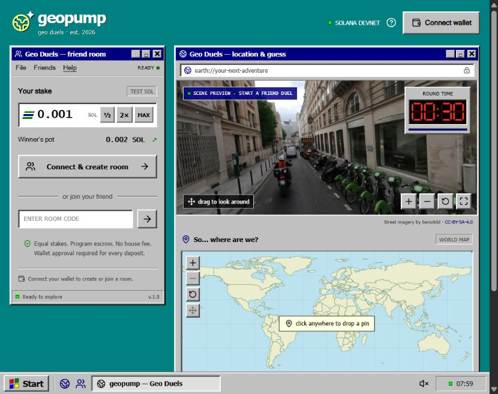

<h1 align="center">geopump</h1>

<p align="center"><strong>Same place. Two guesses. Closest takes the pot.</strong></p>

<p align="center">
  <a href="https://geopumpp.vercel.app/"></a>
  <a href="https://explorer.solana.com/address/9knNnYeDQh1suoAx6tmhAgtmsYQvcoguTn6CkssZArsU?cluster=devnet"></a>
  <a href="#verification"></a>
</p>

<p align="center"></p>

## At a glance

**Geo Duels** drops two friends into the same real 360° street panorama. Each stakes test SOL, finds the location on a world map, and locks a guess before the **30-second** clock expires. The closer player receives both stakes automatically.

The game runs inside a Windows 95 desktop: teal background, navy title bars, beveled controls, a red countdown, and half / 2× / MAX stake shortcuts. The map supports zoom and mouse/touch dragging. Result lines connect both guesses to the revealed target. Rematches require an explicit action; there is no automatic staking.

Stake and pot controls also show a compact USDC market reference using Coinbase SOL-USDC spot, refreshed every 60 seconds. Missing, failed or stale quotes show an unavailable estimate. This is a reference for test SOL: deposits and payouts remain SOL; no USDC is transferred or converted.

**[Play geopump](https://geopumpp.vercel.app/)** · **[Source](https://github.com/debojyoti10CC/geopump)** · **[Rules](Rules.md)**

## Play a round

1. **Connect** Phantom or Solflare in a wallet-capable browser and use devnet test SOL.
2. **Create a room** with a stake from **0.001 to 1 SOL**. Approve the deposit and sign the readable room-access message.
3. **Invite a friend** using the six-character code or room link. A different wallet deposits the same stake.
4. **Explore the shared panorama.** Both confirmed deposits start one synchronized 30-second round. Pan and zoom the scene; move the map to choose your location.
5. **Lock your guess.** Sign the exact room and coordinates. The server acknowledges it only after durable storage. Your opponent’s guess stays private until time expires.
6. **See the result and receipt.** The target, both distances and connecting lines appear. The program pays the recorded winner directly; no separate winner claim is needed.

Wallet approvals and confirmed deposits are distinct. A rejected or pending transaction does not start a funded round. Reconnecting restores the same room and its existing deadline.

## Stakes, scoring and recovery

Amounts use integer lamports throughout. For equal stake **S** and a **zero game fee**:

| At the deadline | Distribution |
| --- | --- |
| Both guesses accepted; one is closer | Winner receives **2S** |
| Equal whole-metre distances | Each receives **S** |
| Only one accepted guess | That player receives **2S** |
| Neither player guesses | Each receives **S** |

Distance uses haversine with Earth radius **6,371,000 m**, rounded to the nearest whole metre. That integer distance decides ties. Network fees and refundable account rent are separate from the pot.

| Window | Fixed rule |
| --- | --- |
| Join | Within 15 minutes of creation; creator can cancel before a second deposit |
| Start | Within 60 seconds of the second deposit, otherwise both stakes become refundable |
| Guess | 30 seconds from the program’s recorded start time |
| Settle | Within 5 minutes after guessing ends, otherwise recorded players can recover their stakes |
| Rent return | Eligible 24 hours after on-chain settlement/refund; scheduled sweep closes to the original rent payer |

The operator pays automatic start, payout, refund and close fees. Wallet-paid timeout recovery works without its private key or fee balance. Recovery still requires the network and deployed program to remain available. Terminal payouts cannot execute twice.

## Architecture

| Layer | Responsibility |
| --- | --- |
| Browser | Windows 95 game, wallet signing, panorama, map pin, countdown and receipt display |
| Vercel | Public domain; proxies game/API/media routes to the Sites Worker |
| Vercel `/api/rpc` | Node.js 22 relay to fixed official devnet; bounded, allowlisted JSON-RPC, never a signing service |
| Sites Worker | Authenticated rooms, private scenes, signed guesses, scoring and referee transactions |
| Cloudflare D1 | Durable rooms/sessions/guesses, pinned program/referee addresses, receipts and close markers |
| Minute cron | Settlement retries, fixed-deadline refunds and eligible 24-hour rent returns |
| Solana program | Room PDA escrow, exact equal deposits, fixed deadlines, target reveal checks and one-time transfers |

Both production wallet and server requests use **`https://geopumpp.vercel.app/api/rpc`**, which forwards to official devnet without an RPC credential. Helius configuration remains stored privately but is inactive; there is **no automatic provider fallback**.

The [Sites backend](https://geo-duels-arcade.ddmpersonalworkspace.chatgpt.site) owns the game database and operator secrets. Vercel does not maintain a second database. Session cookies are host-only, HttpOnly and SameSite Strict; the Worker trusts the exact public origin. Panorama URLs require the authenticated room session.

## Verification

**The public two-wallet flow has passed.** [Recorded round WG4UB2](chain/devnet-game-receipt.json) verified both deposits, two signed guesses, a hidden target during play, authenticated panorama access (`200`), anonymous rejection (`404`), and the exact **2,000,002-lamport** winner balance increase.

| Evidence | Confirmed outcome |
| --- | --- |
| WG4UB2 | [2,000,002-lamport winner payout](https://explorer.solana.com/tx/bn3RyeAnpKaxfq1qV2DRULxRxPPbjwdZfncFBKFGjip27n8m8Z2UQa35hUZh1CRgFTiuG7rwD7PrTYYZcxHjTMb?cluster=devnet) |
| Player round TASTNV | [0.002 SOL two-player payout](https://explorer.solana.com/tx/3R54WRH9XSXe2VnDfku3YBaDbtfaaKoaN9yG3E68Z5V73KEcDddTzbuthsmASfHR69B8mYw9p25X8jPGdQbPf144?cluster=devnet) |
| [Local-validator checks](chain/e2e-receipts.json) | Winner/tie payouts, refunds, rent accounting, invalid commitment and replay rejection |

Passing checks: **15 service + 4 client + 9 referee + 2 wallet + 10 relay + 7 Rust = 47**. They cover durable guesses, signatures/privacy, deposit consistency, wallet broadcast routing, relay restrictions, exact payout arithmetic and rent timing. Test evidence does not replace an independent audit.

The executable devnet program is [`9knNnYeDQh1suoAx6tmhAgtmsYQvcoguTn6CkssZArsU`](https://explorer.solana.com/address/9knNnYeDQh1suoAx6tmhAgtmsYQvcoguTn6CkssZArsU?cluster=devnet). [Deployment metadata](chain/deployment.json) records its binary fingerprint and sponsor. The referee was funded with 5 test SOL.

## Run locally

Use Node.js **22.13+**, npm, and Phantom or Solflare in Chrome, Edge or a compatible wallet browser. Native program work also requires Rust 1.84+ and compatible Solana tooling. The embedded app browser does not provide extension wallets.

```powershell
npm ci
npm run build
```

Configure an ignored `.dev.vars` with the values below. A **new** local D1 database needs all three migrations, using the generated Worker configuration:

```powershell
npx wrangler d1 execute DB --local --config dist/server/wrangler.json --persist-to .wrangler/state --file drizzle/0000_geo_duels.sql
npx wrangler d1 execute DB --local --config dist/server/wrangler.json --persist-to .wrangler/state --file drizzle/0001_pin_escrow_authorities.sql
npx wrangler d1 execute DB --local --config dist/server/wrangler.json --persist-to .wrangler/state --file drizzle/0002_reclaim_escrow_rent.sql
npm run start -- --port 4173
```

Open **http://127.0.0.1:4173/**. For hot reload, use `npm run dev -- --port 4173 --host 127.0.0.1` and initialize its local D1 environment as well. The portable checkout profile uses Vinext; managed Linux uses the supplied build/environment wrappers.

Room play requires a funded devnet referee and a licensed scene catalog with its matching key. Deployed signing keys and the bundled catalog key are intentionally excluded from public source. Independent deployments must supply their own configuration/catalog.

## Runtime configuration

The Sites Worker uses the **`DB`** D1 binding. Production configuration and private keys belong in its runtime secret store.

| Variable | Purpose |
| --- | --- |
| `SOLANA_PROGRAM_ID` | Devnet escrow program address shown above |
| `SOLANA_RPC_URL` | Server RPC; production uses `https://geopumpp.vercel.app/api/rpc` |
| `SOLANA_PUBLIC_RPC_URL` | Browser-safe RPC; production uses the same relay |
| `SOLANA_REFEREE_SECRET` | Server-only 64-byte JSON array or base58 key for the funded referee |
| `GEO_SCENE_SECRET` | Server-only 32-byte hex AES key matching the encrypted catalog |
| `GEO_PUBLIC_ORIGIN` | Exact trusted proxy origin: `https://geopumpp.vercel.app` |
| `GEO_OPERATOR_TOKEN` | Optional secret for authenticated manual sweeps |

For local wallet requests, use an endpoint that permits the local browser origin, such as official devnet; the production relay accepts the game origin only. Never commit `.dev.vars`, `.secrets/`, signing keys, a catalog key or credential-bearing RPC URLs. `scripts/encrypt-scenes.mjs` encrypts a privately supplied `lib/scene-data.server.json` and writes its private key under `.secrets/`.

## Commands and checks

| Command | Purpose |
| --- | --- |
| `npm run dev -- --port 4173 --host 127.0.0.1` | Hot-reload development |
| `npm run check` | Check TypeScript |
| `npm run lint` | Check source style |
| `npm run build` | Build the Sites Worker and browser assets |
| `npm test` | Run all 40 Node service/client/referee/wallet/relay tests |
| `cargo test --manifest-path programs/geo-duels/Cargo.toml` | Run the seven native program tests |
| `node scripts/build-vercel-proxy.mjs` | Prepare Vercel routing plus the Node 22 RPC function |

The seven Rust tests are separate from `npm test`. `scripts/verify-devnet-room.mjs` is an operator integration run that funds fresh test wallets and writes chain evidence; it requires the private local referee file and is not a unit test.

## Repository map

```text
app/                         pages and authenticated Worker API routes
components/                  desktop, panorama, map and wallet interactions
lib/game-*.ts                durable service, scoring, chain bridge and receipts
lib/chain.ts                 PDA derivation, account layout and client instructions
lib/locations.server.ts      server-only scene decryption and media delivery
chain/                       referee, tests and confirmed deployment/round evidence
programs/geo-duels/           native Rust escrow program
drizzle/                     ordered D1 migrations
scripts/                     build wrappers, RPC relay and operator tooling
public/                      world map, viewer and licensed static assets
Architecture.md / Rules.md    technical model and exact round rules
Phases.md / Memory.md         delivery evidence and continuity notes
```

## Trust and operations

This is a **test-SOL devnet prototype**. The hosted referee selects from a limited licensed Panoramax pool, keeps guesses private, accepts timely requests and calculates distances. Commitment/reveal prevents replacing the committed target; it does not independently prove honest scoring, uniform sampling or truthful timeout reports.

The sponsored deployment has **seven-day idle retention** and sponsor-held upgrade authority (`FEvT5nka9qBSXryv65P8ScjvGtfLUE7LgPu1rzuJ38h8`). The registered upgrade owner is recorded separately. Program availability, operator funding and monitoring require maintenance. Mainnet and real-money play have not been authorized or audited.

Panoramax author/license credits accompany scenes and results. Pannellum is MIT-licensed; Natural Earth map data is public domain. See bundled license files and the in-game attribution.
